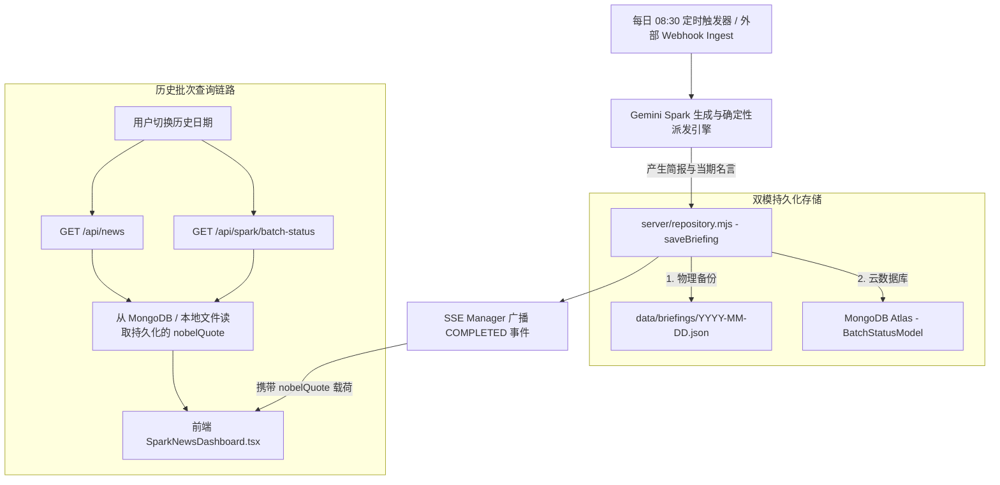

# 诺奖名言每日自动化更新与持久化存储流水线 · 设计规范
(Nobel Quote Daily Pipeline & Dual-Mode Persistence Design Spec)

## 1. 背景与目标 (Background & Goals)

在先前的迭代中，我们完成了 Header 顶部布局统一、度量衡锁定（`h-[42px]`）、自适应字体缩放，并将日期步进器移入分类栏（方案 C）。
根据用户最初的核心需求：
> “下方黑框的位置每天随机生成一句来自诺贝尔文学奖文学作品里的名言及摘自来源和作者，并翻译成中文，**更新、存储逻辑与页面内的资讯逻辑一样**。”

目前前端展示层已有 12 位诺奖作家的智库与界面交互，但名言尚未完全打通至服务端的“每日调度生产、MongoDB/本地文件双写持久化、外部 Webhook 摄取以及历史归档回溯检索”全链路。

本规范旨在将每日诺贝尔文学奖名言彻底与 Gemini Spark 批次简报生命周期 **1:1 深度绑定**，实现：
1. **每日定时自动产出**：每天 08:30 由调度引擎触发或通过外部 Webhook 投递时，与当期资讯同频生成并固化；
2. **云原生双模持久化**：同步写入 MongoDB Atlas (`BatchStatusModel.nobelQuote`) 与本地 `data/briefings/YYYY-MM-DD.json`；
3. **历史归档 100% 可溯**：切换至任意往期日期（如 2026-09-24），呈现该期归档时固化存储的特定名言；
4. **实时推流即时刷新**：当新批次生成或 Webhook 写入完成时，通过 SSE 全网广播，前端 0 延迟平滑替换。

---

## 2. 核心架构与数据流图 (Architecture & Data Flow)



---

## 3. 详细契约定义 (Detailed Contracts)

### 3.1 实体契约 (NobelQuote Schema)

```typescript
export interface NobelQuote {
  year: string;       // 获奖年份，如 "1957 诺贝尔文学奖"
  author: string;     // 作者中文名，如 "阿尔贝·加缪"
  work: string;       // 代表作品，如 "夏天集"
  enAuthor: string;   // 英文作者名，如 "Albert Camus"
  enWork: string;     // 英文作品名，如 "Summer"
  zh: string;         // 中文金句译文
  en: string;         // 英文金句原文
  batchDate?: string; // 归属简报批次日期 (YYYY-MM-DD)
}
```

### 3.2 存储层持久化契约 (`server/repository.mjs`)

1. **`saveBriefing(date, rawData)` 增强**：
   - 提取 `rawData.nobelQuote`；若外部未提供，则自动调用 `getDailyNobelQuote(date)` 确定性派发；
   - 存入本地 JSON：`{ batchStatus, items, nobelQuote }`；
   - 存入 MongoDB：`BatchStatusModel.findOneAndUpdate({ date }, { ...batchStatus, date, nobelQuote }, { upsert: true })`；
   - 函数返回包含 `{ date, itemCount, savedToMongo, nobelQuote }`。

2. **`getBatchStatus(date)` 回显**：
   - MongoDB 模式：读取 `statusDoc.nobelQuote`；若旧数据无该字段，平滑降级至 `getDailyNobelQuote(date)`；
   - 本地文件模式：读取 `localBriefing.nobelQuote` 或 `statusInfo.nobelQuote`；若无则降级至 `getDailyNobelQuote(date)`。

3. **`getNewsList(params)` 回显**：
   - 返回对象的顶级字段包含 `nobelQuote`，供首屏一次性拉取并缓存。

### 3.3 调度引擎契约 (`server/services/scheduler.mjs`)

- 在 `triggerGenerationPipeline(targetDate)` 中：
  - 调用 `generateDailyBriefing(targetDate)`；
  - 组装 `nobelQuote: result.nobelQuote || getDailyNobelQuote(targetDate)` 传入 `saveBriefing`；
  - 在广播 `COMPLETED` SSE 事件时，`data` 载荷中增加 `nobelQuote` 字段。

### 3.4 外部 Webhook 摄取端点 (`POST /api/spark/webhook/ingest`)

- 请求体支持直接传入 `nobelQuote`（便于外部 AI 流水线灵活注入自定义名言）；
- 若请求体未提供 `nobelQuote`，自动调用 `getDailyNobelQuote(targetDate)` 补齐；
- 成功入库响应与广播的 SSE 消息均包含已持久化的 `nobelQuote`。

---

## 4. 实施与验证计划 (Verification Plan)

1. **测试驱动开发 (TDD)**：编写 `tests/nobelQuotePersistence.test.mjs`：
   - 验证确定性哈希在同日期下的绝对幂等性与跨日期变异性；
   - 验证 `saveBriefing` 对本地文件及 MongoDB 模型的名言落盘；
   - 验证 Webhook 接收自定义名言与默认保底名言的持久化；
   - 验证 `getBatchStatus` 能够准确读出持久化的名言。
2. **全量回归验证**：
   - 运行全部单元测试（测试总数达 55+ 项且 100% 绿灯）；
   - 运行 `npm run build` 确保 TypeScript 与 Vite 生产构建 0 错误。
